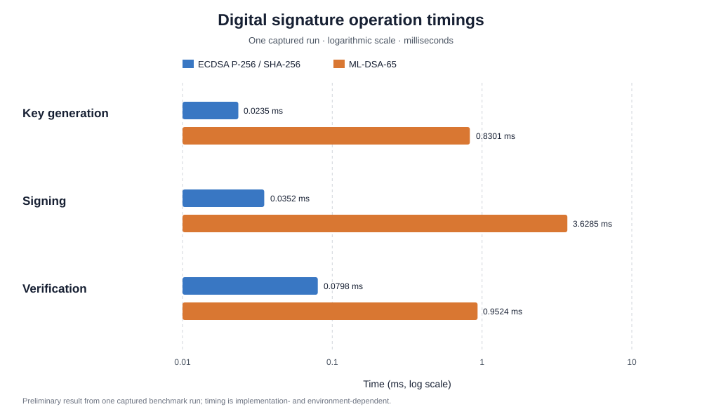
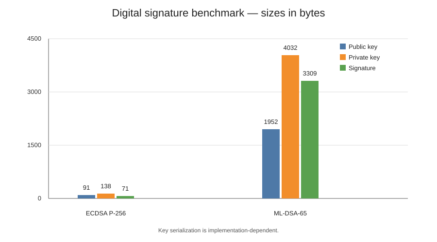

# Бенчмарк цифровых подписей: ECDSA P-256 и ML-DSA-65

## Цель

Сравнить время трёх операций и размеры ключей/подписей для классической схемы ECDSA P-256 с SHA-256 и постквантовой схемы ML-DSA-65.

## Результаты одного сохранённого запуска

| Метрика | ECDSA P-256 / SHA-256 | ML-DSA-65 | ML-DSA-65 / ECDSA |
|---|---:|---:|---:|
| Генерация ключей, мс | 0.023483 | 0.830144 | 35.35× |
| Создание подписи, мс | 0.035171 | 3.628480 | 103.14× |
| Проверка подписи, мс | 0.079765 | 0.952442 | 11.94× |
| Открытый ключ, байт | 91 | 1952 | 21.45× |
| Закрытый ключ, байт | 138 | 4032 | 29.22× |
| Подпись, байт | 70 | 3309 | 47.27× |

## Автоматические тесты

По сохранённому логу pytest: **20 passed in 2.72s**. Это означает, что имеющийся набор автоматических тестов прошёл в зафиксированном окружении; результат не доказывает криптографическую стойкость алгоритмов.

## Окружение

- Python 3.12.10
- cryptography 50.0.2
- liboqs-python 0.16.0.1
- pytest 9.1.1
- qiskit 2.5.2
- qiskit-aer 0.17.2

Полный список пакетов и исходные логи находятся в [`results/logs/`](logs/).

## Интерпретация и ограничения

В этом запуске ML-DSA-65 показал большее измеренное время всех трёх операций и большие размеры ключей и подписи. Подпись ML-DSA-65 была примерно в 47.27 раза больше ECDSA-подписи.

Размер ECDSA зависит от формата сериализации: в данном эксперименте указаны размеры, измеренные конкретной программной реализацией, а не только математический размер кривой.

**Важное ограничение:** предоставлен один запуск бенчмарка. В сохранённом выводе не указано число повторений, поэтому эти значения следует считать предварительными, а не статистически устойчивой оценкой. Для итоговой статьи рекомендуется выполнить несколько серий, зафиксировать число повторов и условия запуска, а затем сообщить среднее или медиану и разброс.

Измерения производительности и размеров не доказывают устойчивость к квантовым атакам. ML-DSA-65 — постквантовая схема цифровой подписи; ECDSA P-256 — классическая схема, которой угрожает алгоритм Шора при наличии достаточно мощного отказоустойчивого квантового компьютера.
